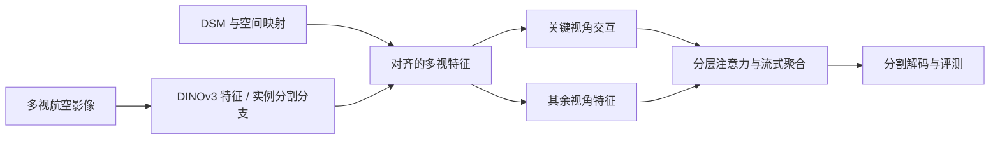

# Multi-view Building Segmentation

面向倾斜航空影像的多视特征融合与建筑物分割研究代码。包含 DINOv3 特征适配、Mask2Former 实例分割分支、DSM/空间数据处理，以及关键视角引导的 SAIL-style 分层融合模块。

**Built with DINOv3.** DINOv3、Mask2Former 及其他第三方组件的归属和许可证见 [THIRD_PARTY.md](THIRD_PARTY.md)。



## 主要实现

- `layers/sail_image_memory.py`：关键视角上下文、anchor/tail 注意力与分块流式融合。
- `layers/single_r_swin_set.py`、`layers/tail_local_context.py`：视角和局部空间上下文模块。
- `models/normal_model_interface_dinov3_mask2former.py`：DINOv3 + Mask2Former 分支。
- `models/fusion_model_interface_dinov3_crossattn.py`：多视特征融合训练接口。
- `data/datasets/`：多视/空间特征加载、视角存在标记与采样。

实例分割分支和多视融合分支具有不同配置。当前融合配置使用 UPerHead；不能将所有分支混称为同一个 DINOv3 + Mask2Former 端到端模型。

## 无数据的模块验证

```bash
python -m venv .venv
source .venv/bin/activate
pip install -r requirements-core.txt
python tools/check_source.py
python tools/run_core_tests.py
```

已有测试覆盖稠密与流式融合的一致性、缺失视角、null-tail 分支及局部特征模式。测试只用随机张量，不需要航空影像、DSM 或模型权重，不代表真实场景精度。

## 完整训练与推理

建议 Linux。实际研究环境使用 Python 3.9、PyTorch 2.7.1、Lightning 2.5.1.post0、Detectron2 0.6、timm 1.0.15；GDAL、MMCV 与可变形注意力扩展须按本机 CUDA/系统库单独配置。

原 `requirements.txt` 已另存为 `requirements-historical.txt`，其中旧 Torch 1.13.1 环境早于当前 DINOv3 实现，不应作为当前完整训练的锁定环境。

1. 获取所需预训练模型及自行准备的影像、DSM、实例/分割标签和空间映射。
2. 在 `cfgs/` 中复制对应分支配置，修改全部 `/path/to/...` 路径和 GPU 设备编号。
3. 核实 train/val 的地域、建筑物和样本划分，避免同一建筑物的不同视角跨集合。
4. 使用以下入口（`-cfg` 接受 `cfgs/` 下不含 `.yaml` 的文件名）：

```bash
python main_crossattn_train.py -cfg YOUR_FUSION_CONFIG
python main_multi_q_predict.py -cfg YOUR_PREDICTION_CONFIG
```

示例 YAML 说明的是原研究结构和数据格式，并非开箱即用的公共数据集配方。部分示例明确为候选消融方案，不能据此声称已训练或达到某一精度。

## 结果与复现状态

本仓库发布真实实现、配置示例和模块测试。尚未在本次整理中核实与简历“F1 提升 2.4 个百分点”一一对应的基线、配置、数据划分和权重，因此不将该数值列为仓库可复现的 benchmark。
航空数据和训练权重未随源码发布，完整训练/实例分割流水线未在此次发布检查中重跑。模块检查的实际结果见 [VALIDATION.md](VALIDATION.md)。

## 上游项目

- [DINOv3](https://github.com/facebookresearch/dinov3)
- [Mask2Former](https://github.com/facebookresearch/Mask2Former)
- [Detectron2](https://github.com/facebookresearch/detectron2)
- [MMSegmentation](https://github.com/open-mmlab/mmsegmentation)

## 使用边界

代码来自实际项目，仓库整理不等于重新执行完整训练与全数据评测。历史结果、数据范围和选参限制分别在文档中披露；合成输入的测试不代表真实数据集精度。
数据集、个人信息、服务器配置、模型权重和中间特征不随源码发布。请按各数据集和预训练模型的官方说明获取所需文件。
