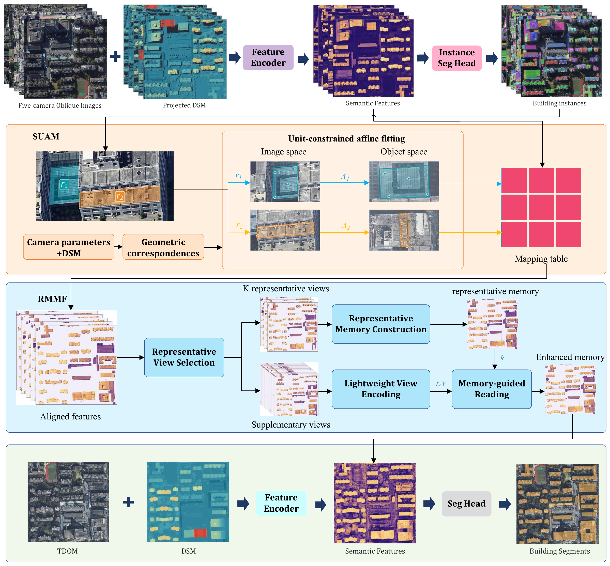
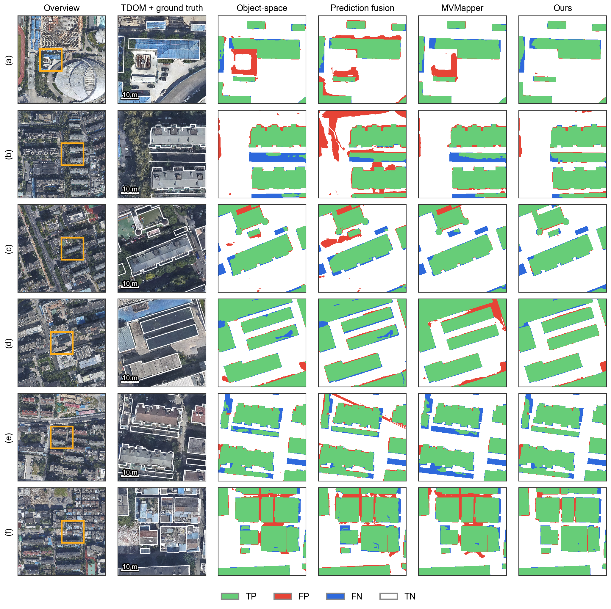

# Multi-view Building Segmentation · SUAM + RMMF

面向五镜头倾斜摄影的建筑物提取研究代码：通过 **SUAM（结构单元约束仿射映射）**将多视像方特征对齐至物方，再通过 **RMMF（代表性记忆引导的多视融合）**整合代表视图与补充观测，输出物方建筑物分割结果。

论文初稿报告：杭州数据集上 **IoU 87.36%、F1 93.25%**，相比 MVMapper 分别提高 **2.23、1.28 个百分点**。这些是已有实验记录，并非此次仓库整理重新训练得到的结果。

**Built with DINOv3.** DINOv3、Mask2Former 及其他第三方组件的归属和许可证见 [THIRD_PARTY.md](THIRD_PARTY.md)。

## 方法概览



1. **像方表征与实例预测**：利用 DINOv3 特征和 Mask2Former 实例分支获取像方特征及结构单元预测。
2. **SUAM 几何对齐**：结合相机参数与 DSM 建立对应点，保留结构单元实例身份，分别拟合局部仿射变换并限制作用范围，减少相邻结构共用映射参数的问题。
3. **RMMF 多视融合**：选取 K 个真实代表视图构建记忆 R，由 R 查询轻量编码的补充观测，形成增强记忆 M。这里 Q 来自 R，K/V 来自补充视图。
4. **物方分割**：将 M 与 TDOM、DSM 提供的物方特征融合，经 UPerNet 解码得到建筑物掩膜。

五个镜头类别不等于每个样本仅有五张影像；记忆 R 表示空间多视信息，不是时序历史状态。详细方法及代码对应关系见 [方法说明](docs/METHOD.md)。

## 实验结果

下表摘自论文初稿主实验，指标单位为 %；SUAM + RMMF 使用 K=5、补充视图预算 T=96。

| 方法 | IoU | F1 | Precision | Recall |
|---|---:|---:|---:|---:|
| 物方模型 | 83.39 | 90.95 | 92.12 | 89.80 |
| 结果级多视融合 | 79.42 | 88.53 | 84.99 | 92.38 |
| MVMapper | 85.13 | 91.97 | 92.45 | 91.49 |
| **SUAM + RMMF** | **87.36** | **93.25** | **95.02** | 91.55 |



从左至右为区域概览、TDOM 与真值轮廓、物方模型、结果级融合、MVMapper 和本文方法。绿色为正确检出，红色为误检，蓝色为漏检，白色为正确背景；第二列白线为真值轮廓。局部示例与全测试区域的汇总指标应结合阅读。

映射消融中，P3 相比 P2 的 **F1 提高 2.38 个百分点**；融合对照中，RMMF 相比 Masked Mean 的 **F1 提高 1.02 个百分点**。二者使用不同对照，不能混称为同一项增益。完整表格、设置和来源见 [实验说明](docs/RESULTS.md)。

## 主要实现

- `layers/sail_image_memory.py`：代表视图上下文、anchor/tail 注意力与分块流式融合；保留历史文件命名。
- `layers/single_r_swin_set.py`、`layers/tail_local_context.py`：视角和局部空间上下文模块。
- `models/normal_model_interface_dinov3_mask2former.py`：DINOv3 + Mask2Former 分支。
- `models/fusion_model_interface_dinov3_crossattn.py`：多视特征融合训练接口。
- `data/datasets/`：多视/空间特征加载、视角存在标记与采样。

实例分割分支和多视融合分支具有不同配置。当前融合配置使用 UPerHead；不能将所有分支混称为同一个 DINOv3 + Mask2Former 端到端模型。

## 无数据的模块验证

```bash
python -m venv .venv
source .venv/bin/activate
pip install -r requirements-core.txt
python tools/check_source.py
python tools/run_core_tests.py
```

已有测试覆盖稠密与流式融合的一致性、缺失视角、null-tail 分支及局部特征模式。测试只用随机张量，不需要航空影像、DSM 或模型权重，不代表真实场景精度。

## 完整训练与推理

建议 Linux。实际研究环境使用 Python 3.9、PyTorch 2.7.1、Lightning 2.5.1.post0、Detectron2 0.6、timm 1.0.15；GDAL、MMCV 与可变形注意力扩展须按本机 CUDA/系统库单独配置。

原 `requirements.txt` 已另存为 `requirements-historical.txt`，其中旧 Torch 1.13.1 环境早于当前 DINOv3 实现，不应作为当前完整训练的锁定环境。

1. 获取所需预训练模型及自行准备的影像、DSM、实例/分割标签和空间映射。
2. 在 `cfgs/` 中复制对应分支配置，修改全部 `/path/to/...` 路径和 GPU 设备编号。
3. 核实 train/val 的地域、建筑物和样本划分，避免同一建筑物的不同视角跨集合。
4. 使用以下入口（`-cfg` 接受 `cfgs/` 下不含 `.yaml` 的文件名）：

```bash
python main_crossattn_train.py -cfg YOUR_FUSION_CONFIG
python main_multi_q_predict.py -cfg YOUR_PREDICTION_CONFIG
```

示例 YAML 说明的是原研究结构和数据格式，并非开箱即用的公共数据集配方。部分示例明确为候选消融方案，不能据此声称已训练或达到某一精度。

## 结果与复现状态

本仓库发布研究实现、配置示例、模块测试，以及经论文初稿和已有结果目录交叉核对的实验摘要与原始图件。图件来源和文件校验信息见 [assets/README.md](assets/README.md)。

航空数据、缓存特征和训练权重未随源码发布；完整预处理、训练与全量评测尚未在此次发布检查中重跑，也尚未建立每张结果表与公开配置、检查点的一一对应关系。因此，上述表格属于 **manuscript-reported results**，不是一键复现承诺。模块检查的实际结果见 [VALIDATION.md](VALIDATION.md)。

## 上游项目

- [DINOv3](https://github.com/facebookresearch/dinov3)
- [Mask2Former](https://github.com/facebookresearch/Mask2Former)
- [Detectron2](https://github.com/facebookresearch/detectron2)
- [MMSegmentation](https://github.com/open-mmlab/mmsegmentation)

## 使用边界

代码来自实际项目，仓库整理不等于重新执行完整训练与全数据评测。历史结果、数据范围和选参限制分别在文档中披露；合成输入的测试不代表真实数据集精度。
数据集、个人信息、服务器配置、模型权重和中间特征不随源码发布。请按各数据集和预训练模型的官方说明获取所需文件。
