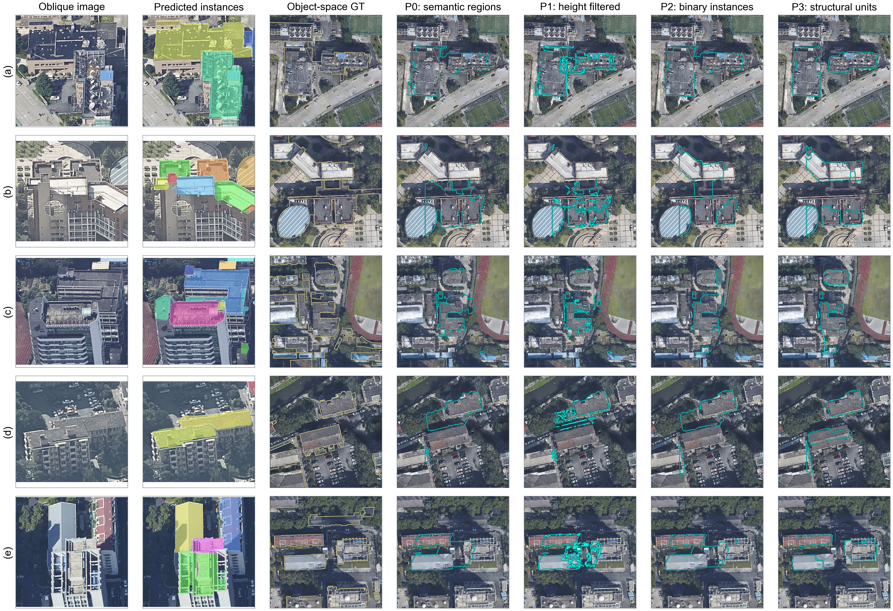

# 方法与代码导航

本说明依据论文初稿 *Building Extraction from Oblique Photogrammetric Imagery through Multiview Fusion with Structural-Unit-Constrained Mapping and Representative Memory* 整理。论文框架图见[首页](../README.md)，发布的图件沿用原稿内容。

## 研究问题

倾斜摄影为同一区域提供大量重复观测，但遮挡、相邻建筑结构粘连及视图冗余会影响像方信息向物方的转换与融合。该项目分别从几何映射和多视信息组织两个环节处理这些问题。

数据包括杭州五镜头航空影像、相机定向参数、TDOM、DSM 和建筑物标签。原稿统计 2,375 幅像方影像、12,744 个物方样本组；每组关联 20–148 幅影像，中位数 100。关联影像数不等于逐像素有效观测数，也不等于最终参与融合的视图数。物方样本块尺寸为 512 × 512。

## SUAM：结构单元约束仿射映射

像方模型使用 DINOv3 特征与 Mask2Former 实例分支。SUAM 保留预测结构单元的实例身份，以相机参数和 DSM 建立的像方—物方对应点为基础，按单元分别拟合局部仿射变换，并限制每个变换的作用范围。对齐时通过逆映射采样像方特征，同时屏蔽越界或无效位置。

结构单元不必对应一整栋建筑，实例编号也不是跨视图的建筑物身份。该方法避免几何关系不同的相连区域共用一组仿射参数，但不能恢复被遮挡而未观测到的信息。

图中依次为倾斜影像、预测实例、物方真值及 P0–P3 映射结果。黄色是真值边界，青色是有效映射支持范围的边界，不能将青色轮廓直接解释为最终建筑物分割结果。四种映射策略的定义及量化结果见[实验说明](RESULTS.md)。

## RMMF：代表性记忆引导的多视融合

从候选观测中选取 K 个真实代表视图，充分建模其空间和集合上下文，得到代表性记忆 R。补充观测采用轻量编码，由 R 提供查询 Q，补充视图编码特征提供 K/V，读取后形成增强记忆 M。这里的注意力键 K 与代表视图数量 K 是不同概念。

增强记忆 M 与物方分支特征 O 拼接，经融合层及 UPerNet 解码得到物方二值建筑物掩膜。物方分支利用 TDOM 与 DSM 信息，训练采用 Dice 与 Focal 损失。物方特征 O 不承担上述补充视图读取中的查询角色。

原稿采用分阶段流程：像方特征和映射关系预先生成并缓存，之后进行物方融合训练。它不是每次迭代均重新估计映射的完整端到端流程。SAIL-Recon 是借鉴来源；RMMF 才是原稿中的方法名称。

## 代码对应关系与发布范围

| 路径 | 作用 |
|---|---|
| [实例分支接口](../models/normal_model_interface_dinov3_mask2former.py) | DINOv3 + Mask2Former 像方分支 |
| [仿射变换工具](../AffineTransform/affine_transform.py) | 仿射估计与变换基础函数 |
| [多视记忆模块](../layers/sail_image_memory.py) | 代表视图记忆、补充视图读取和流式聚合 |
| [代表视图上下文](../layers/single_r_swin_set.py) | 空间与视图集合上下文建模 |
| [补充视图局部上下文](../layers/tail_local_context.py) | 补充路径的局部特征处理 |
| [融合训练接口](../models/fusion_model_interface_dinov3_crossattn.py) | 多视融合与分割训练 |
| [数据加载](../data/datasets/) | 缓存特征、空间数据和视图有效性标记 |

历史文件名中的 `sail`、`anchor`、`tail` 保留用于代码兼容。论文框架说明覆盖完整研究流程，而当前仓库提供其研究模块和配置示例；仿射基础函数本身不等于完整 SUAM 数据预处理流水线。完整数据准备和论文配置复现仍需原始数据、对应缓存及检查点。
